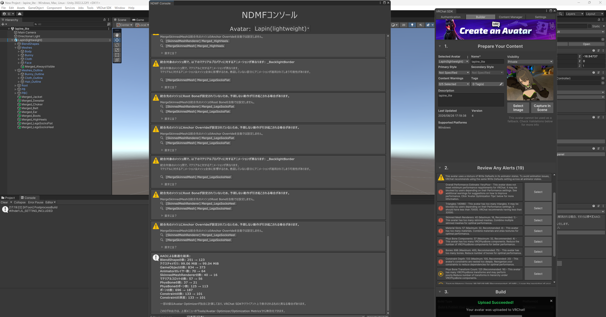
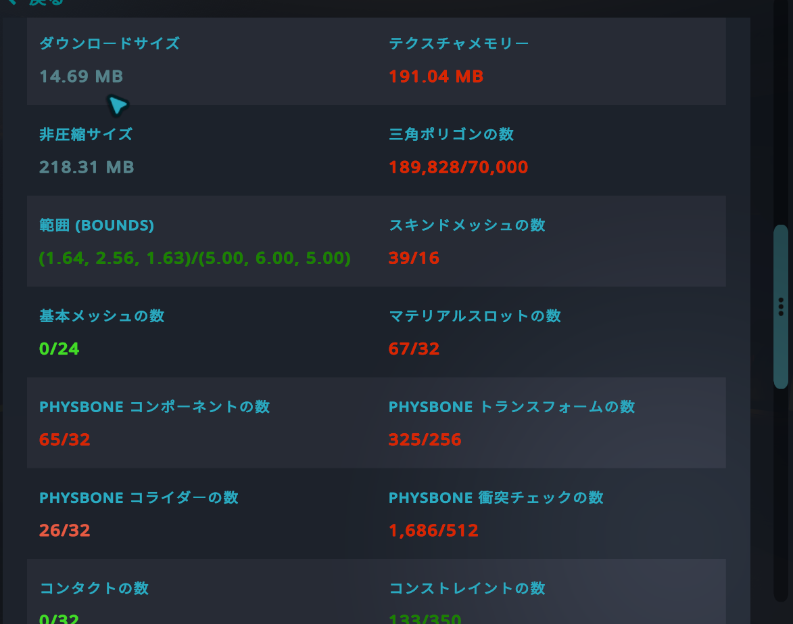
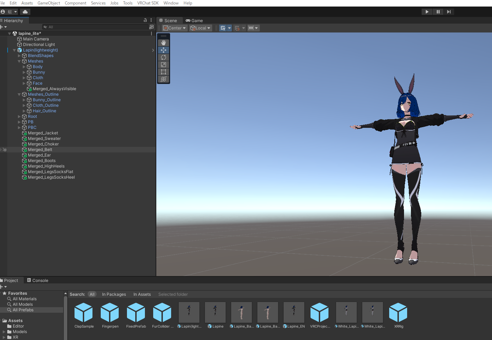
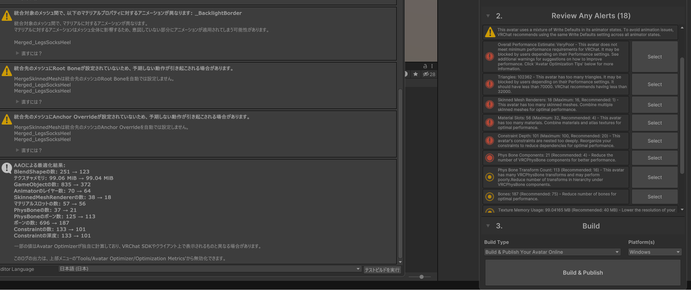
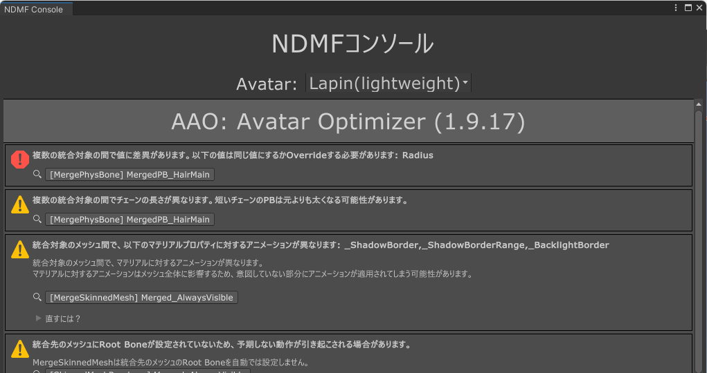
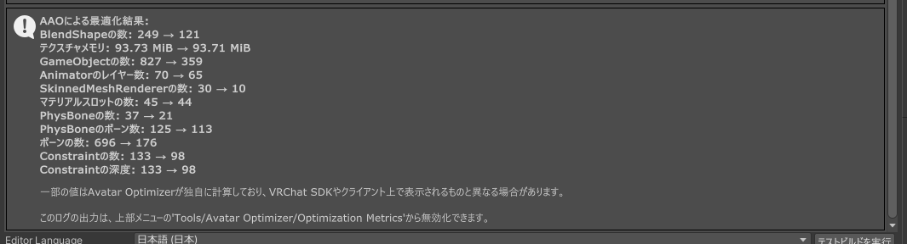
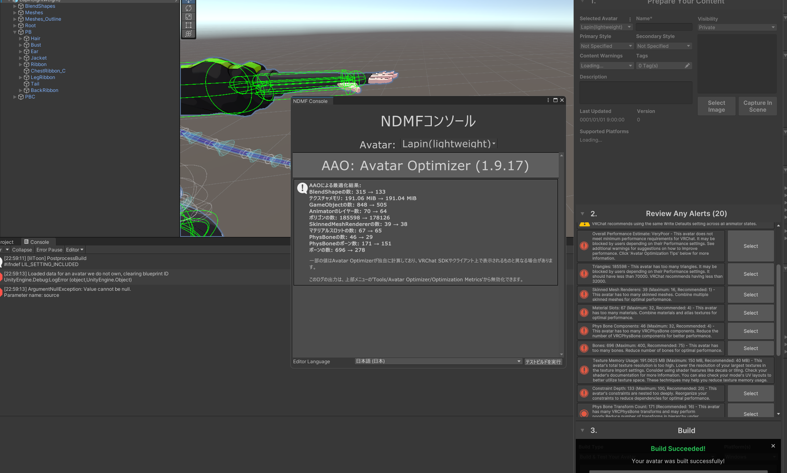
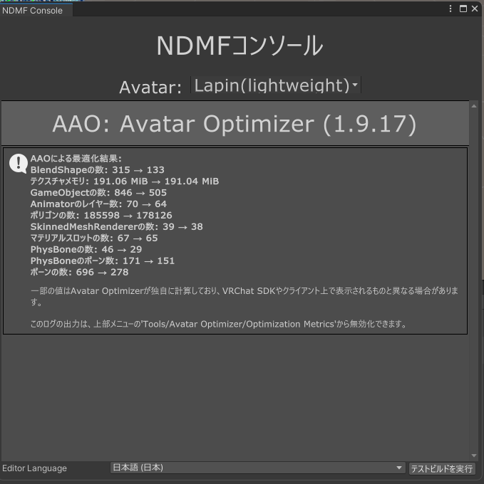
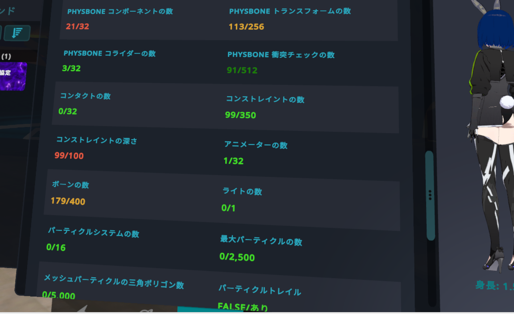

## はじめに

普段VRChatで使っているアバター「Lapine」(WARPSTORE製)は、フルスペック版だとかなり重量級で、パフォーマンスランクは**Very Poor**。普段使いはそのままでいいとしても、重いワールドに行くとブロックされたり周りに迷惑をかけたりするので、**別プロジェクトとして「軽量版」を作る**ことにした。名付けて `Lapin(lightweight)`。

方針は最初からこう決めていた。

- オリジナル(フルスペック版)は普段使い用にそのまま残す
- 軽量版は「重い時の保険」として別途用意する
- ツールはUnity 2022.3.22f1 + VCC + **AAO(Avatar Optimizer)** + **NDMF** + **Meshia Cascading Avatar Mesh Simplifier**
- 実際の作業はClaude Codeと二人三脚で進める

この記事は2026年8月下旬の作業記録で、ツールのバージョン(AAOは1.9.17)や仕様はその時点のもの。

結論から言うと、最終的にはVery Poorから**Poor**まで引き上げることに成功した。ただしその道のりは、想像よりずっと泥沼だった。この記事はその記録。

## 出発点の数字

作業開始時点(すでにある程度手を入れた後)のパフォーマンス統計はこんな感じだった。

| 項目 | 値 | 上限(Poor基準) |
|---|---|---|
| Triangles | 140,980 | 70,000 |
| Skinned Mesh Renderers | 40 | 16 |
| Material Slots | 57 | 32 |
| PhysBone Components | 37 | 32 |
| Bones | 696 | 400 |
| Constraint Depth | 101 | 100 |
| テクスチャメモリ | 191MB | 150MB |

見ての通り、**ほぼ全項目で上限オーバー**。Very Poor確定という状態からのスタートだった。

*この記事の出発点にした時点のUnity画面(8/26 17:19)。SDKパネルは Triangles 140,980、Skinned Mesh Renderers 40、Material Slots 57、PhysBone Components 37 と、軒並み上限超え。*

さらに前、作業初日(8/25朝)に実機で見たパフォーマンス表示はこちら。

*作業初日(8/25朝)の実機表示。三角ポリゴン189,828/70,000、スキンメッシュ39/16、マテリアルスロット67/32、PhysBoneコンポーネント65/32。*

## 第一の壁: 「保存したはずなのに消える」Unity Prefabの罠

作業を始めてまず最初にぶつかったのが、地味だけど厄介な問題だった。AAOの`MergeSkinnedMesh`で服のパーツをグループごとに統合していったのだが、**せっかく作った統合結果が、Prefabファイルに保存されていない**という事態が何度も起きた。

*MergeSkinnedMeshで衣装パーツごとに統合した結果(Merged_Jacket、Merged_Sweater…)。*

原因は「シーン上でPrefab Instanceを直接編集すると、変更は『オーバーライド』としてシーン側に留まり、Prefabアセット本体には反映されない」というUnityの基本仕様。Ctrl+Sでシーンを保存しても、Prefab InstanceのOverrides→Apply Allをやらないと、次に別の場所からそのPrefabを読み込んだときには変更前の状態に戻ってしまう。

さらに厄介なのは、**再コンパイルを伴う作業(新しいスクリプトの追加など)の前にこの保存を怠ると、せっかくの作業がまるごと消える**という点。この「保存忘れ」による巻き戻りは、プロジェクトを通して何度も再発した(後述するGrove_Meshの騒動もこれが遠因)。

最終的に一番確実だった対処法は、**シーンのPrefab Instance経由ではなく、`PrefabUtility.SaveAsPrefabAsset`でPrefabアセットに直接書き込む**方式に切り替えること。この方式だとApply All漏れという概念自体が発生しないので、根本的に安全になった。

## 第二の壁: Triangleが全然減らない ― 「20個しか登録されていない」問題

Triangles 140,980を70,000まで落とすために、Meshia Cascading Avatar Mesh Simplifierを導入し、目標を65,000に設定した。ところが実際にビルドしてみると、**実測は102,362**。目標に対して37,000近く足りていない。

*Meshia導入後のビルド。Triangles 102362、Skinned Mesh Renderers 18。目標の65,000には届いていない。*

原因調査の結果、驚くべき事実が判明した。**アバター全体には38個のSkinnedMeshRendererが存在するのに、Meshiaに登録されていたのはたった20個だけ**だった。残り18個は簡略化もマージも一切受けずに、フル解像度のまま素通りしてビルドに含まれていた。

犯人はMeshiaの仕様。`RefreshEntries()`はInspectorを開いた時にしか実行されず、しかも非アクティブなオブジェクトは`GetComponentsInChildren`で最初から拾われない。つまり**トグルで隠されている衣装バリエーション(非アクティブな予備メッシュ)が、根こそぎ登録から漏れていた**。

登録済み20個のTargetTriangleCountを合計するとちょうど65,000(目標値)に一致していたことが、この仮説の決め手になった。「数字が理論値とぴったり一致する」というのは、こういうデバッグでは何よりも信頼できる証拠になる。

洗い出しの結果、以下のような仕分けが必要だと分かった。

- 過去にすでに「使わない」と決めていたメッシュ(Body_Mesh、Dress_Meshなど) → 予想通りEditorOnlyのままだったものと、実は巻き戻っていたもの(後述)が混在
- 現役の衣装だが単に登録漏れだったもの(Boots、Legs_Socks系のフラット版など) → 過去の合意通り正式に削除
- 目・眉のカラーチェンジ機能(Eye_Mesh/Eyebrow_Mesh) → 使っていないので現状維持(非アクティブのまま)

ここで一つ重要な教訓を得た。**非アクティブなメッシュも、VRChatのパフォーマンス統計にはしっかりカウントされる。** 「隠しているから軽い」わけではない。

## 第三の壁: 髪の毛が言うことを聞かない

PhysBone Components(物理演算コンポーネント)が37個(上限32個)あり、その54%が髪の毛のPhysBoneだった。AAOの`MergePhysBone`で複数のボーンを1つにまとめる作業に入ったのだが、ここでも一筋縄ではいかなかった。

まず、統合対象のPhysBoneは「同じ親を持っている」ことが条件になるが、髪の各房はバラバラの位置に生えているのでこの条件を満たさない。そこで`Make Children of Me`(新しい共通の親を作ってそこに再配置する)オプションを使うことにした。

ビルドしてみると、今度は**Radius(揺れ判定の太さ)の値が統合対象の間でバラバラ**というエラーで失敗。事前にspring/stiffness/gravityは一致していると確認していたのに、Radiusだけチェック漏れがあった。ここを揃えて再ビルド。

*MergePhysBoneがRadiusの不一致で止まったときのNDMFコンソール。*

ビルド自体は通ったが、今度は**見た目が壊れた**。前髪が目にかかって邪魔になり、サイドヘアが「もふっと固まって」動かなくなる謎の症状。原因は、`Make Children of Me`で作られた新しい親オブジェクトが、**Headボーンの子になっておらず、頭の動きに追従していなかった**こと。「見た目の位置は保持される」という説明は、あくまで再配置した瞬間の話であって、その後Headが動いたときにどうなるかは別問題だった。ここを直して、ようやく髪はまともに動くようになった。

PhysBone Componentsは最終的に37→21まで削減でき、上限32を余裕でクリアした。

*PhysBone統合直後のAAOログ(8/26 19:37)。PhysBoneは37→21、SkinnedMeshRendererは30→10。この時点でテクスチャメモリは93.73MiBまで下がっていたが、この後のMaterial Slots対応で再び膨らむことになる。*

## 第四の壁: SDKパネルは嘘をつく(正確には「別のものを見ている」)

このプロジェクトを通して一番混乱させられたのが、**VRChat SDKの「Review Any Alerts」パネルに出てくる数字が、実際のビルド結果と一致しない**という現象だった。

例えば、AAOの最適化ログには「SkinnedMeshRendererの数: 38→18」と出ているのに、同じ画面のSDKパネルには「Skinned Mesh Renderers: 30」のような、明らかに矛盾する数字が表示される。何度も「悪化した!?」と焦らされた。

*SDKパネルの表示。Triangles 185598、Skinned Mesh Renderers 39。*

*同じアバターのAAOログ。ポリゴンは185598→178126、SkinnedMeshRendererは39→38、ボーンは696→278と、SDKパネルとは別の数字が出ている。*

正体はこうだった。NDMF(Non-Destructive Modular Framework)を使うと、メッシュの統合や簡略化は**非破壊**、つまり実際のビルド時にだけ一時的に適用される。ところがSDKのパフォーマンスパネルは、`AvatarPerformance.CalculatePerformanceStats`という関数に**シーン上の生の状態**をそのまま渡しているだけで、NDMFのビルド結果とは完全に無関係に動いている。パネルが壊れているのではなく、「NDMF適用前の状態を毎回正直に表示しているだけ」だった。ただし**EditorOnlyタグだけは尊重して除外する**という、中途半端に賢い挙動もしていたので、余計に混乱に拍車をかけた。

これに対処するため、Claude Codeが`AvatarProcessor.ManualProcessAvatar`(NDMFの内部API)を使って、複製アバターに実際にフルパイプラインを適用し、処理後の実メッシュから直接カウントする検証スクリプトを作ってくれた。これのおかげで、**VRChatに実際にアップロードしなくても正確な最終数値を確認できる**ようになった。この一連のプロジェクトの中でも、地味にいちばん役立ったツールだったと思う。

## 第五の壁: 過去の決定が何度も「巻き戻る」

このプロジェクトでは、「以前こう決めたはずなのに、また元に戻っている」という現象が繰り返し発生した。

- Grove_Mesh(手袋)が、以前「有効に戻す」と決めたはずなのに、なぜかEditorOnlyに巻き戻っていた(実際には自分で先に手動修正していたのだが、Claude Code側の調査タイミングの問題で一時的にすれ違いが発生した)
- Boots_Meshなど「削除済み」のはずの衣装が、EditorOnlyタグが外れて復活していた
- Expression Wheelメニューに、すでに使えなくなった「ブーツ」の選択肢が残っていて、選ぶと脚が消えるという実害のあるバグになっていた

原因はほぼ全て、第一の壁で説明した「Prefab保存忘れ」の別バリエーションだった。この経験から学んだのは、**「過去に決めたこと」を記録しておくだけでは不十分で、定期的に実際の状態と照合する必要がある**ということ。特にPrefabのタグのような「地味で見た目に影響が出るまで気づきにくい設定」は要注意。

## 第六の壁: Material Slotsの罠 ― 間違ったツール、そして黒塗り事件

Material Slots(57→32まで削減する必要があった)の対応では、まず**ツール選定ミス**から始まった。AAOには`Merge Toon Lit Material`というコンポーネントがあるのだが、これは**AAO独自のToonLitシェーダー専用**で、今回のアバターは全部lilToonシェーダーだったため候補が0件になり、そもそも使えなかった。正しくは`Merge Material`という別のコンポーネントを使う必要があった。

`Merge Material`は「同じレンダラー内で、完全に同じShaderアセットを使っているマテリアル同士」しか統合できない。lilToonは通常マテリアルとアウトライン用マテリアルで別のShaderアセットになるため、名前が似ていても混ぜられない、という制約もあった。

丁寧にグループ分けとテクスチャアトラス化を進め、Material Slotsは57→31まで削減できた。ところが実機で確認すると、**胸元の一部が真っ黒に塗りつぶされる**という不具合が発生。原因は、統合したマテリアルの片方(Cloth_Hand_M)はアルファマスク機能がONで、もう片方(Body_M、肌部分)はOFFだったのに、`Merge Material`は統合後に**1つの設定に強制的に統一してしまう**仕様だったこと。結果、本来不透明のはずの肌にアルファマスクが適用され、透明(黒抜け)になっていた。

この修正では、深追いせず該当のマージを撤回するという安全側の判断をした。

## 第七の壁: 数字は揃ったのに、実機で見た目が崩れる

Triangles・Material Slots・PhysBone・Bones・Constraint Depthの6項目が全部クリアになった時点で、「これで完成だ」と思った。ところが実機でVRChatにアップロードして確認すると、**総合ランクは依然としてVery Poor**のまま。

原因はテクスチャメモリだった。実測すると**264.40MB**(上限150MB)まで膨れ上がっていた。理由は、`Merge Material`が「明示的に設定したテクスチャプロパティ」だけでなく、**ソース間で値が異なる全テクスチャプロパティを、無条件にグループの出力サイズでベイクしてしまう**仕様だったこと。「_MainTexしか指定していないはずなのに、実は3枚が4096×4096でベイクされていた」というような、想定外の肥大化があちこちで起きていた。

各アトラスのサイズを元のテクスチャ解像度に合わせて縮小し、264MB→121MBまで削減。ようやく全項目クリアになった……はずが、今度は**肌の一部が灰色になる**、**脚が二重に表示される**、**目や口が埋もれて見える**という、見た目の不具合が3つ出てきた。これらは軽量化の過程で「目立たない部分」として簡略化率を上げすぎていたメッシュ(まつ毛・アイシャドウのデカール、髪、セーター周り)が原因で、優先順位を調整して復元することで解決した。

この一連の流れから得た教訓は、**「パフォーマンス統計が全部クリアになった」ことと「実際に壊れていないこと」は別問題**だということ。数字だけを見て安心せず、必ず実機での目視確認を挟む必要がある。

## 大きな決断: 着せ替え機能を諦める

ここまでの作業を振り返って、ふと気づいたことがあった。**繰り返し発生していたトラブル(タグの巻き戻り、統合グループの不整合、Expression Menuとの整合性、アルファマスクの黒塗り)は、ほぼ全部「複数の衣装パターンを両立させようとしている」ことから生まれていた。**

そこで方針を転換。「普段使いはオリジナル(フルスペック版)、これはあくまで重い時用の軽量版」という位置づけを踏まえ、**軽量版では衣装を1着に固定し、着せ替え機能をまるごと諦める**ことにした。合わせて、ジャケットの着脱に使っていた「耳引っ張りギミック」も、切り替え先がなくなる以上不要と判断し、Expression Menu・パラメータごと削除した。

この判断によって、衣装ごとのMergeSkinnedMeshグループ管理、Expression Menuの整合性チェック、トグルアニメーションとの対応関係など、これまで散々苦しめられてきた複雑さがまるごと不要になった。数字的にも、Triangles・Material Slots・テクスチャメモリすべてに大きな余裕が生まれた。

## Mediumは諦めた ― FBXに焼き込まれた壁

Poorが見えてきたところで、「せっかくならMediumも目指せないか」という欲が出た。ここで初めて、Good/Medium/Poorそれぞれの正確な閾値を、VRChat SDK内の実ファイル(`Good_Windows.asset`、`Medium_Windows.asset`)を直接読んで確認した。

結果、**Constraint Depth(現在98、Medium基準は80以下)が絶対的なブロッカー**であることが判明した。この133個のConstraint(RotationConstraint 97個、PositionConstraint 22個、ParentConstraint 14個)は、**FBXファイルに直接焼き込まれたHumanoid互換リターゲティング用リグ**であり、Unity上でのプレハブ編集では一切削減できない。修正するには元の3Dソフトウェアでリグ自体を作り直す必要があり、それは今回のスコープを大きく超える作業だった。

また、副次的な発見として「表情のブレンドシェイプ数はパフォーマンスランクに一切関与しない」ことも確認できた。VRChatのパフォーマンス評価スキーマには、そもそもBlendShape数を評価する項目自体が存在しなかった。

Mediumに届かない項目を並べると、ブロッカーは次の3つだった。

| 項目 | 最終値 | Medium基準 | Poor基準 |
|---|---|---|---|
| Constraint Depth | 98 | 80以下 | 100以下 |
| Material Slots | 31 | 16以下 | 32以下 |
| PhysBone Components | 21 | 16以下 | 32以下 |

Constraint Depthの閾値はGood 50 / Medium 80 / Poor 100で、Poorの基準ですら98とギリギリだった。しかもこれはFBXに焼き込まれたリグ由来なので、Unity側ではどうにもならない。Material SlotsとPhysBoneは頑張れば詰められそうでも、Constraint Depthだけは動かせない。

Constraint Depthという「範囲外の壁」がある以上、他の項目をどれだけ削ってもMediumには届かない。無理に押し進めて今の安定した状態を崩すリスクを取るより、**Poorを最終ゴールとして確定する**ことにした。

## 最終結果

一連の作業を経て、最終的にはこのあたりまで持っていくことができた。

| 項目 | 開始時 | 最終(Poor達成時点) | 上限(Poor基準) |
|---|---|---|---|
| Triangles | 140,980 | 65,000〜68,000程度 | 70,000 |
| Skinned Mesh Renderers | 40 | 8〜10 | 16 |
| Material Slots | 57 | 31 | 32 |
| PhysBone Components | 37 | 21 | 32 |
| Bones | 696 | 176〜179 | 400 |
| Constraint Depth | 101 | 98〜99 | 100 |
| テクスチャメモリ | 191MB | 111〜121MB | 150MB |

なお、Constraint DepthはSDKパネル上では最後まで133のまま表示される(第四の壁と同じ理由)。表の98〜99は、NDMFの処理後に実測した値。

*VRChat実機での表示。PhysBoneコンポーネント21/32、コンストレイントの深さ99/100、ボーンの数179/400。*

さらにその後、衣装を1着に固定してギミックを削除したことで、上記よりもう一段の余裕(Triangles換算でさらに1万以上の削減見込み)を確保している。

## 振り返って学んだこと

- **NDMFを使うアバターでは、VRC SDKパネルの数字を鵜呑みにしない。** 実際の値は、NDMFログの処理後の値か、`AvatarProcessor.ManualProcessAvatar`のような手段で確認する
- **非アクティブなメッシュもパフォーマンス統計にはカウントされる。** 「隠しているから軽い」は間違い
- **Prefab Instanceをシーン上で直接編集すると、保存忘れ・巻き戻りの温床になる。** 可能なら`PrefabUtility.SaveAsPrefabAsset`でPrefabアセットに直接書き込む方式にする
- **AAOやMeshiaのような自動化ツールも、登録漏れ・仕様の見落としがある前提で疑ってかかる。** 「目標値ぴったりの数字が出ているか」は、登録漏れを見抜く良い手がかりになる
- **マテリアル統合(MergeMaterial)は、統合対象のトグル系プロパティ(アルファマスクなど)が一致しているか要注意。** 一致しないと、見えないところで機能が漏れ出す
- **数字が全部クリアになっても、必ず実機で目視確認する。** パフォーマンス統計と実際の見た目の破綻は別問題
- **時にはパフォーマンス目標そのものを見直す判断も必要。** 着せ替え機能を諦めるという決断は、最初は抵抗があったが、結果的にこのプロジェクトを何度も苦しめてきたトラブルの根本原因を取り除くことになった
- **FBXに焼き込まれた制約(今回で言えばConstraint Depth)は、Unity上の作業だけでは超えられない壁になることがある。** 無理に追いかけず、現実的なゴールを設定する

長丁場だったが、Very PoorからPoorまで、根拠を持って地に足のついた形で辿り着けたのは、良い経験だったと思う。
